[Español](README.md) · **English**

<p align="center">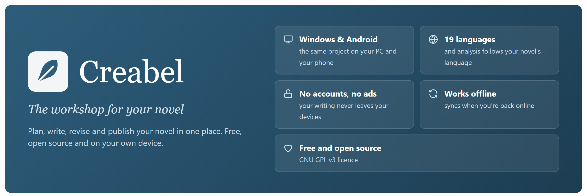</p>

Creabel brings together everything that holds a novel up: chapters and scenes, characters,
places and other records, timeline, continuity, text analysis, writing guides and export to Word,
EPUB, PDF and plain text. Your projects are stored on your own device.

## Download

- **Windows**: from the **Microsoft Store** (search for “Creabel”), which installs it without
  warnings and keeps it up to date. Or with the `Creabel_X.Y.Z_x64-setup.exe` installer from
  [Releases](https://github.com/weto91/creabel/releases), which tells you when a new version is
  out and updates with one click. Use one or the other on each PC, not both.
- **Android**: `Creabel_X.Y.Z_android.apk`, from [Releases](https://github.com/weto91/creabel/releases)
  (coming to Google Play too).

## A look at Creabel

*The screenshots show a sample project: the novel and its characters are made up.*

### Each project’s home

The cover, the line that sums up your novel, where you left off, what to write next and how the
book is going: words, today’s goal, streak and deadline.

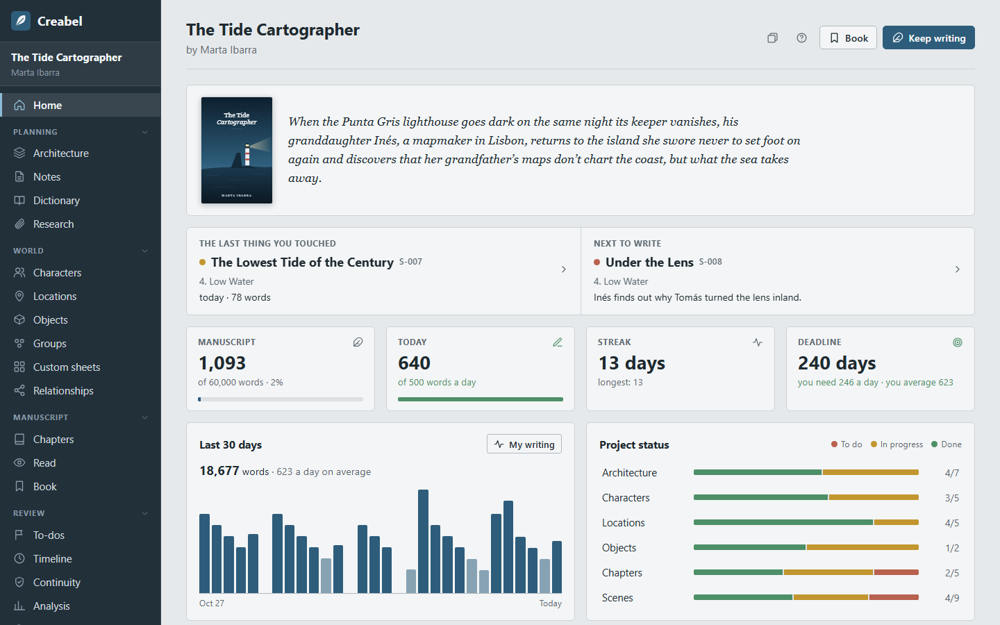

### Writing

A calm editor made for long sessions. Beside it, the scene sheet: who’s in it, where and when it
happens, which strands it moves forward, its to-dos and its revisions.

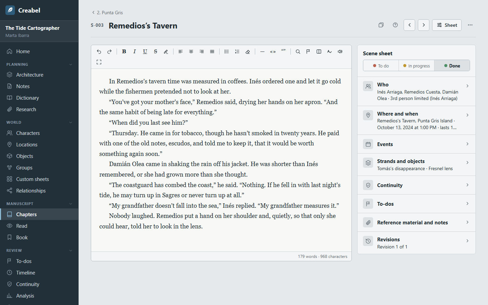

### Tag it once, Creabel connects everything

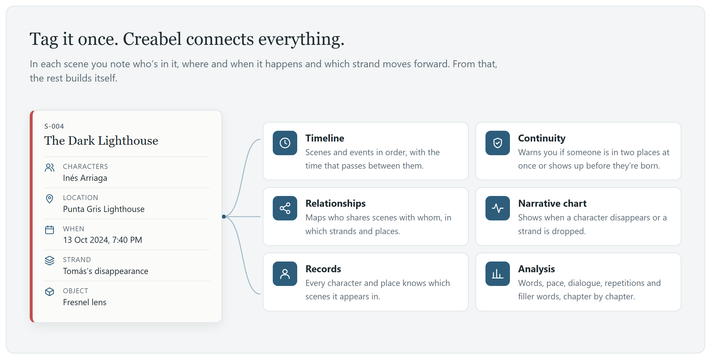

### Characters through an interview

Each character is built by answering questions section by section (personal details, appearance,
psychology, beliefs…). Creabel pulls their key traits out of what you write and knows which scenes
they appear in.

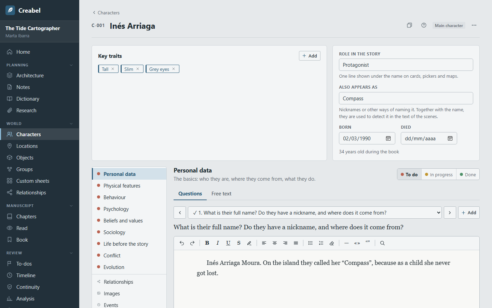

### The whole novel at a glance

The board has a column per chapter and a card per scene, coloured by strand. Drag the cards to
reorder them. Shown here with the dark theme.

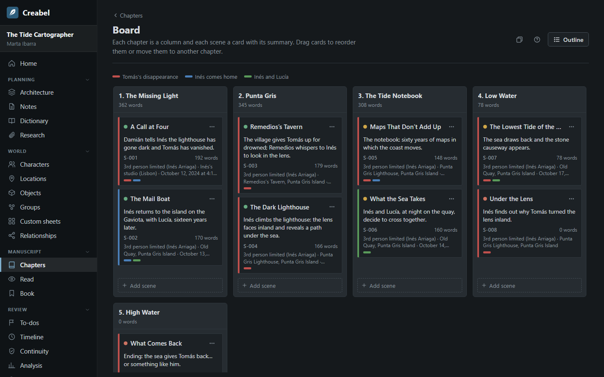

### When everything happens

The timeline puts scenes and events in date order (including those before the book begins) and
tells you how much time passes between them.

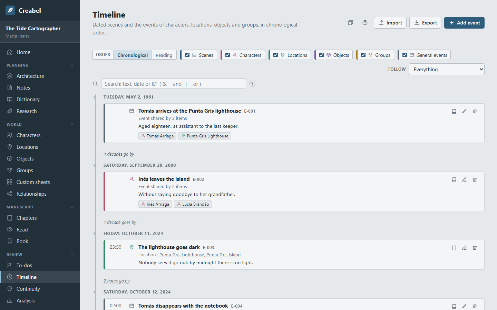

### Relationships that draw themselves

Who shares scenes with whom, which character goes to which places, who drives each strand…
Creabel works it out from what you have already noted. You can also draw your own maps.

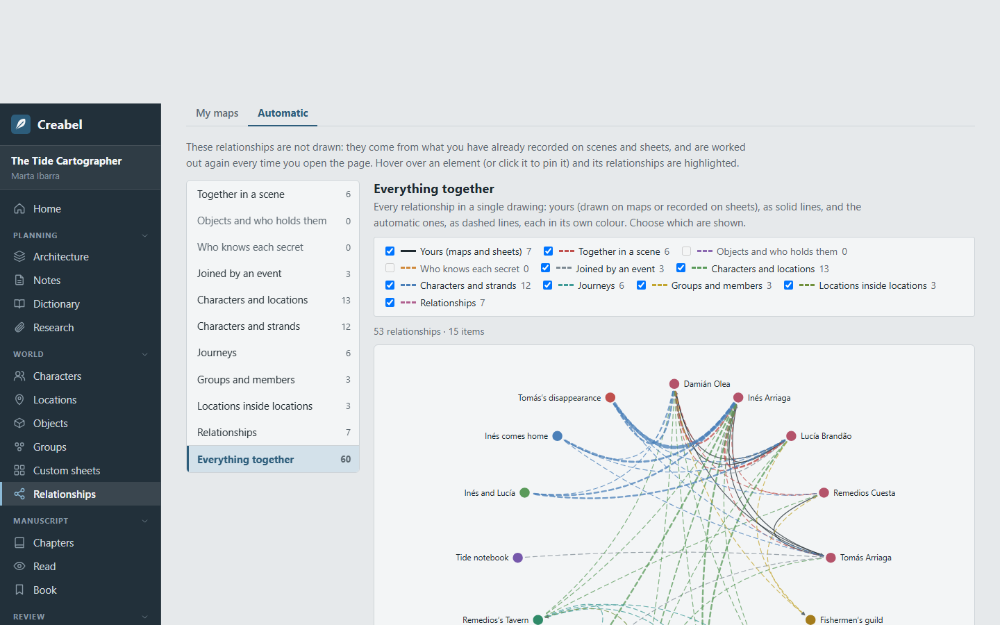

### Your pace and your style

Words per day, streaks, a forecast of when you’ll finish, activity over the last months, and a
style review (repetitions, filler words, long sentences, dialogue) following the rules of your
novel’s language.

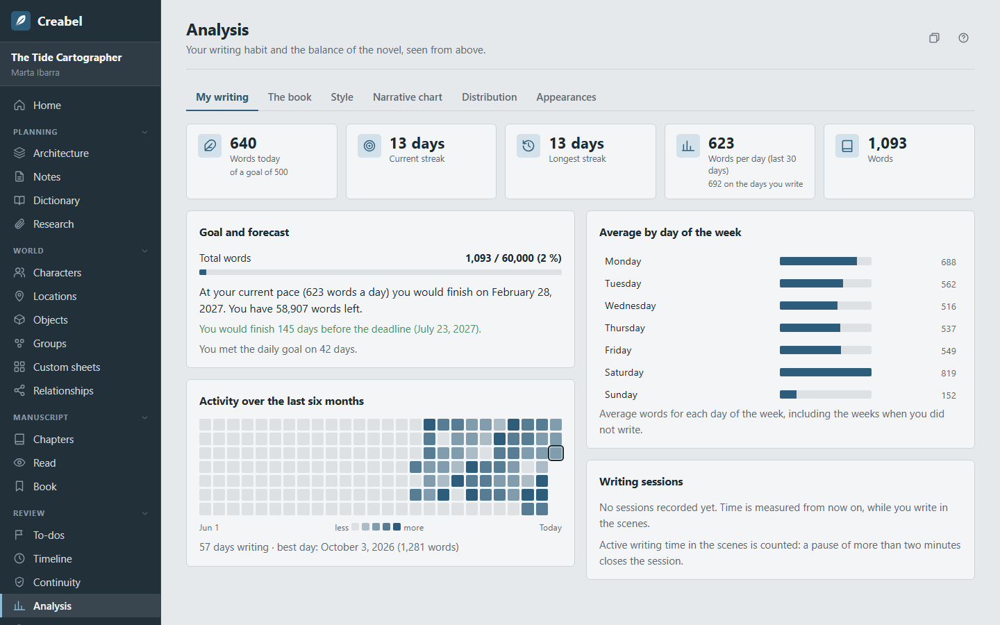

### On your phone

The same novel on your phone or tablet, with a bottom bar you can reach with your thumb and a
button to jump back to the scene you were in.

<p align="center">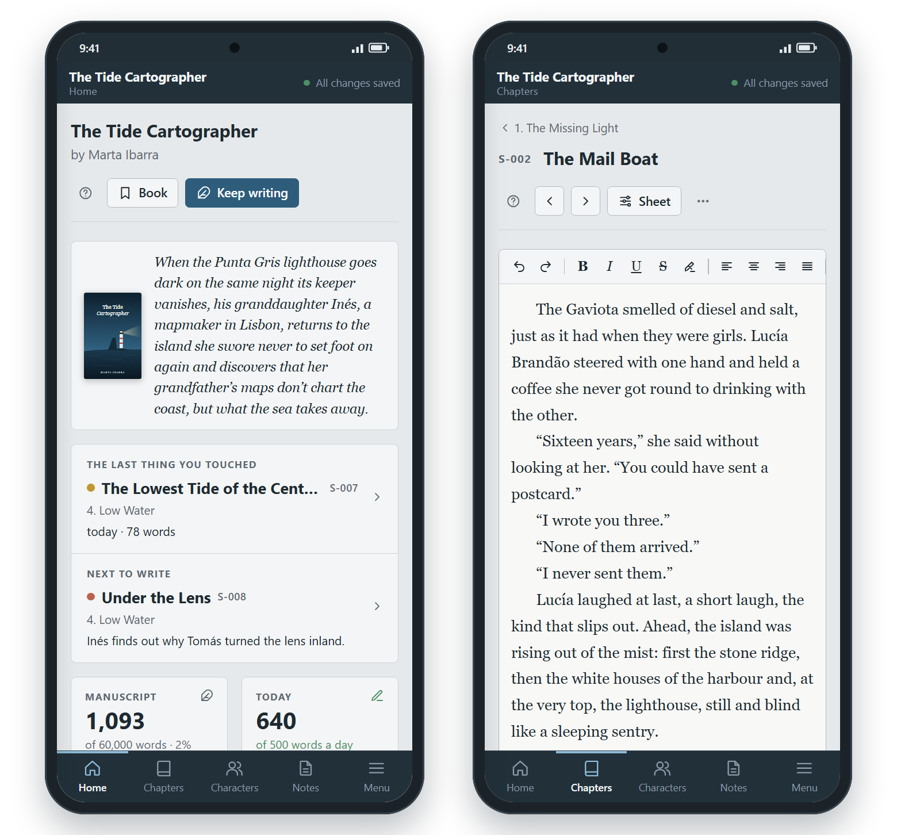</p>

### The whole journey

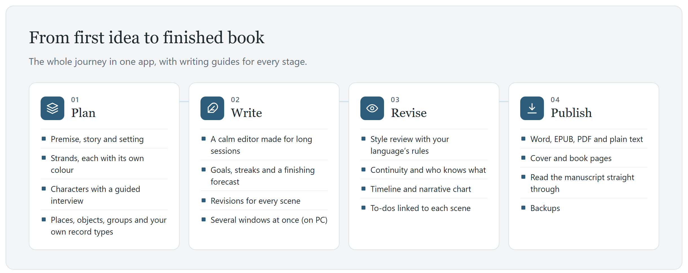

## Your data

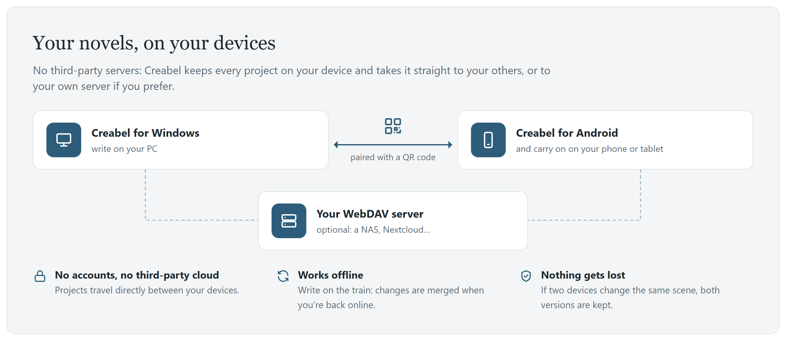

Creabel collects no data at all: see the [privacy policy](PRIVACIDAD.md#creabel-privacy-policy).

## Support the project

Creabel is free and has no ads. If it helps you with your novel, you can support its development:
https://paypal.me/weto1991.

## Licence

[GNU GPL v3](LICENSE) with [additional terms](LICENSE-ADDITIONAL-TERMS.md#english): anyone who
copies or modifies Creabel must publish their code under the same licence, keep the attribution
visible (Álvaro Rubio Adán, [github.com/weto91](https://github.com/weto91) and the donation link)
and use a different name for their version.

## Acknowledgements

Creabel is inspired by [bibisco](https://github.com/andreafeccomandi/bibisco), by Andrea
Feccomandi: some ideas about how to organise a novel and some of the sample questions for the
records come from it. bibisco is free software under the same licence (GNU GPL v3).

## How it’s built

- `app/`: the interface (HTML, CSS and JavaScript, with no dependencies or build step).
- `src-tauri/`: the native app ([Tauri 2](https://v2.tauri.app)): window, updates and
  permissions.
- `scripts/` and `.github/workflows/`: automatic builds and releases with GitHub Actions.
- `CHANGELOG.md`: the changes in each version (in Spanish).

Building on your own machine needs Node.js, Rust and, for Android, Android Studio with the NDK:

```bash
npm install
npx tauri icon src-tauri/app-icon.svg
npx tauri dev
```

© Álvaro Rubio Adán — [github.com/weto91](https://github.com/weto91)
