**Español** · [English](README.en.md)

<p align="center">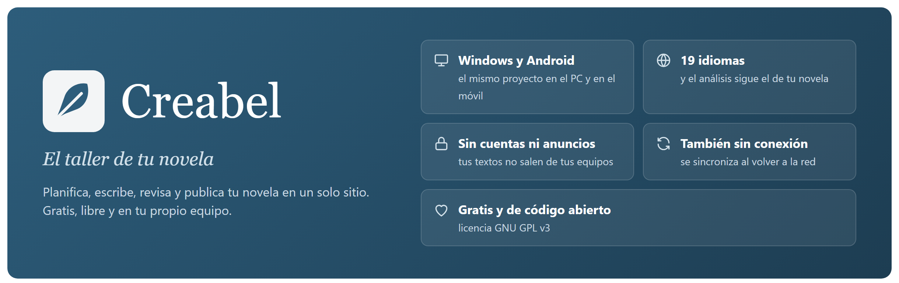</p>

Creabel reúne en un solo sitio todo lo que sostiene una novela: capítulos y escenas, personajes,
lugares y demás fichas, línea temporal, continuidad, análisis del texto, guías de escritura y
exportación a Word, EPUB, PDF y texto. Los proyectos se guardan en tu propio dispositivo.

## Descargar

- **Windows**: en **Microsoft Store** (busca «Creabel»), que la instala sin avisos de Windows y
  la actualiza sola. O con el instalador `Creabel_X.Y.Z_x64-setup.exe` de
  [Versiones](https://github.com/weto91/creabel/releases), que avisa cuando hay una versión nueva
  y se actualiza con un clic. Usa una de las dos en cada PC, no las dos a la vez.
- **Android**: en [Google Play](https://play.google.com/store/apps/details?id=io.github.weto91.creabel),
  que la actualiza sola. O con `Creabel_X.Y.Z_android.apk`, de
  [Versiones](https://github.com/weto91/creabel/releases). Las dos van firmadas igual: se puede
  pasar de una a otra sin desinstalar.

## Así es Creabel

*Las capturas son de un proyecto de ejemplo: la novela y sus personajes son inventados.*

### El inicio de cada proyecto

Portada, la frase que resume la novela, por dónde ibas, lo siguiente por escribir y cómo va el
libro: palabras, objetivo del día, racha y fecha de entrega.

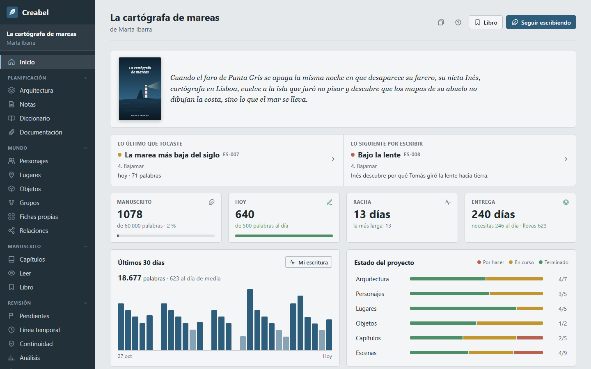

### Escribir

Un editor tranquilo, pensado para muchas horas. Al lado, la ficha de la escena: quién sale, dónde
y cuándo pasa, qué tramas avanza, sus pendientes y sus revisiones.

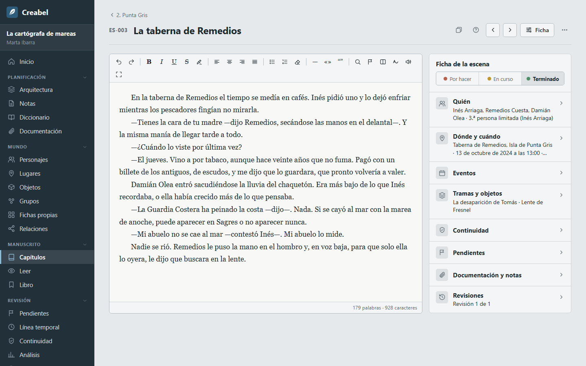

### Apuntas una vez, Creabel lo cruza todo

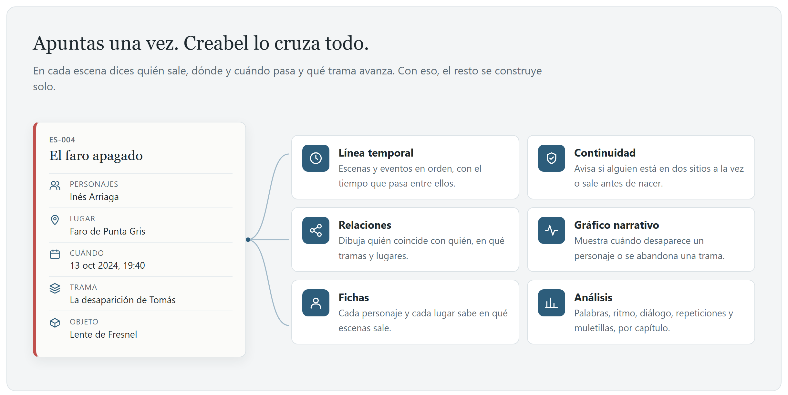

### Personajes con entrevista

Cada personaje se construye respondiendo preguntas por secciones (datos personales, aspecto,
psicología, creencias…). Creabel saca de lo que escribes sus rasgos clave y sabe en qué escenas
aparece.

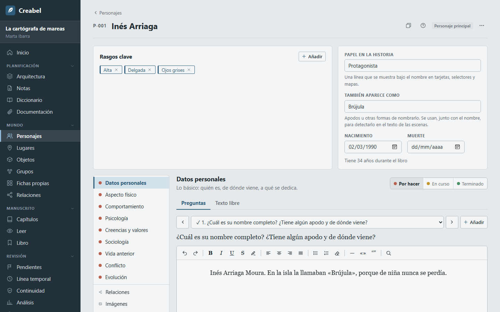

### La novela de un vistazo

El tablero tiene una columna por capítulo y una tarjeta por escena, con el color de cada trama.
Las tarjetas se arrastran para cambiar el orden. Aquí, con el tema oscuro.

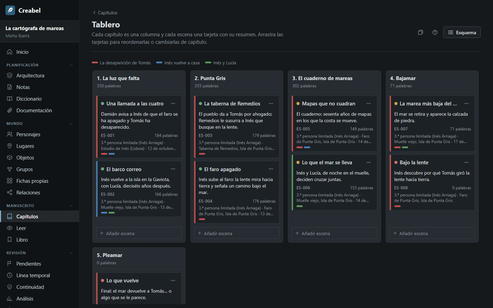

### Cuándo pasa cada cosa

La línea temporal ordena escenas y eventos por fecha (también los de antes de que empiece el
libro) y dice cuánto tiempo pasa entre uno y otro.

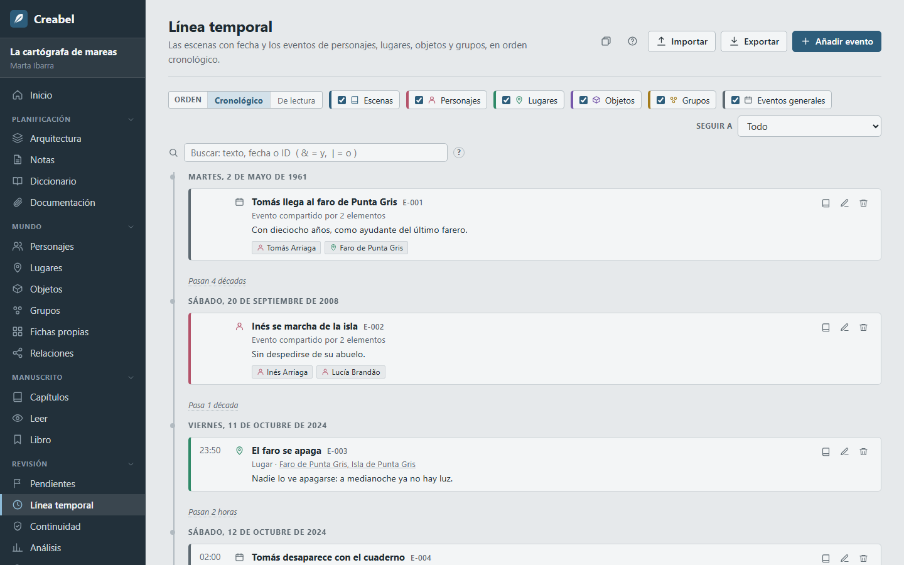

### Relaciones que se dibujan solas

Quién coincide con quién, qué personaje recorre qué lugares, quién avanza cada trama… Creabel lo
deduce de lo que ya has apuntado. También puedes dibujar tus propios mapas.

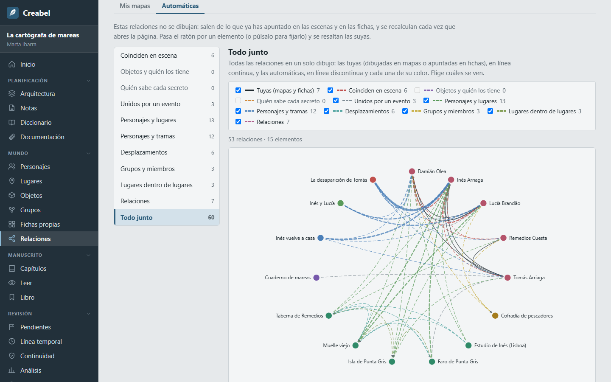

### Tu ritmo y tu estilo

Palabras al día, rachas, previsión de cuándo terminarás, actividad de los últimos meses, y una
revisión de estilo (repeticiones, muletillas, frases largas, diálogo) con las reglas del idioma de
tu novela.

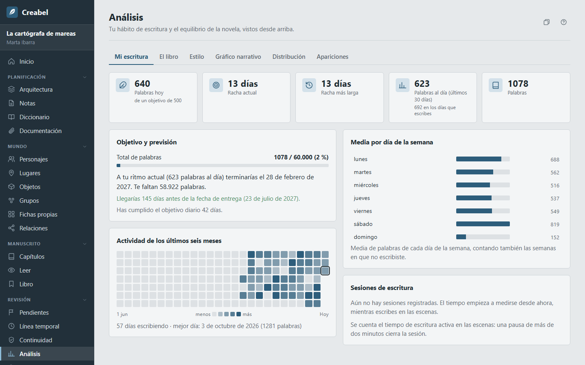

### En el móvil

La misma novela en el teléfono o la tableta, con una barra abajo para moverse con el pulgar y un
botón para volver a la escena en la que estabas.

<p align="center">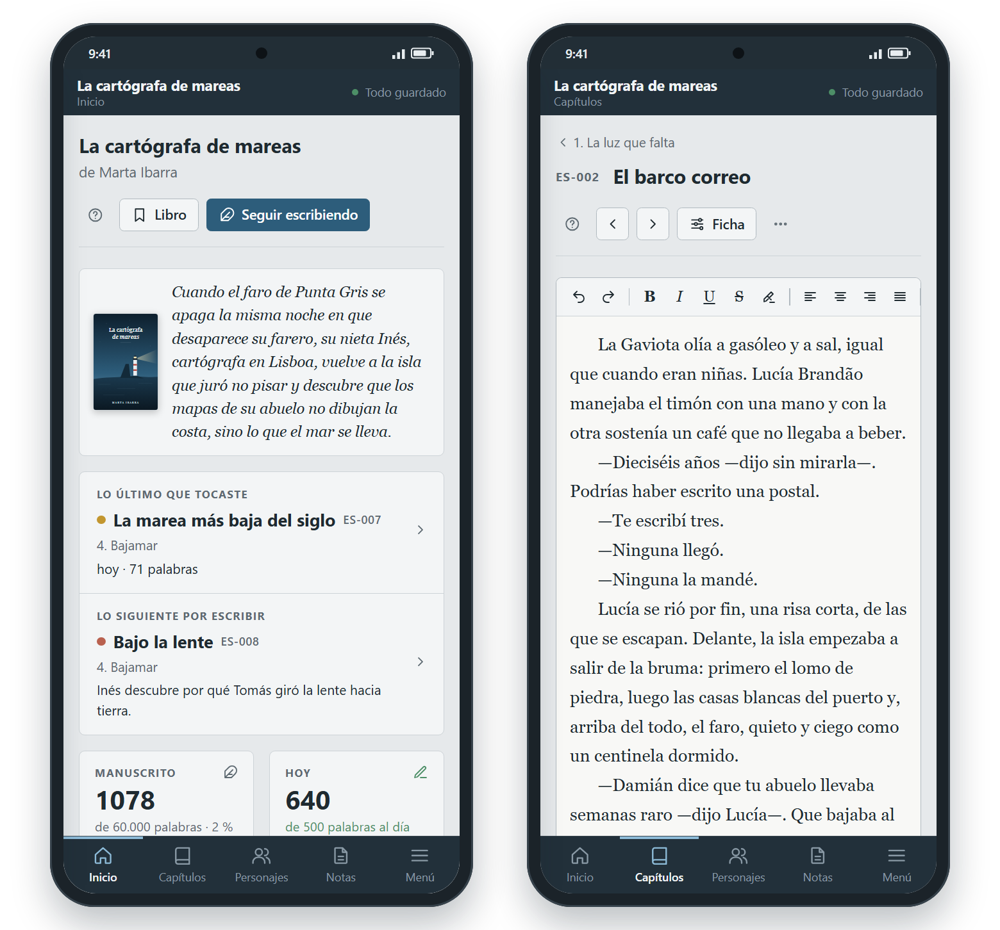</p>

### Todo el camino

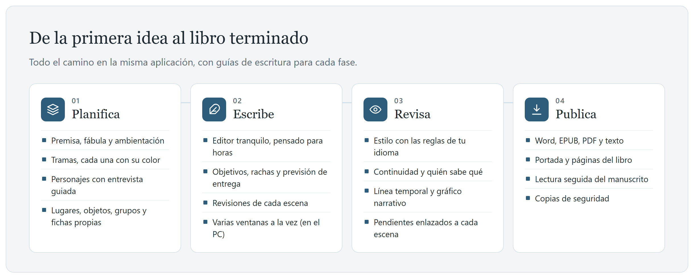

## Tus datos

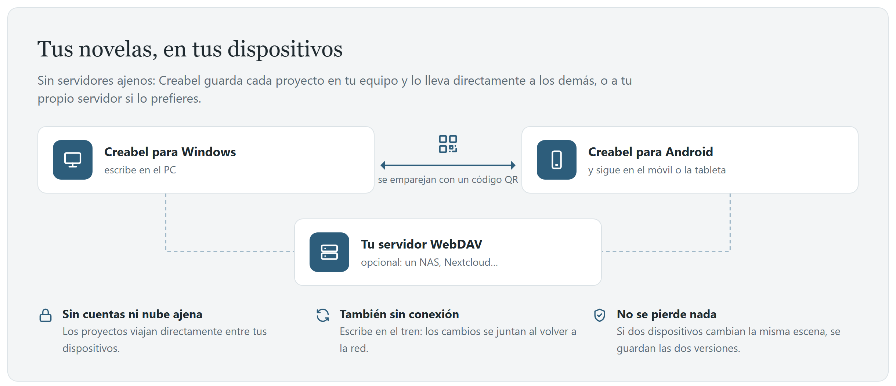

Creabel no recoge ningún dato: ver la [política de privacidad](PRIVACIDAD.md).

## Apoyar el proyecto

Creabel es gratuita y sin anuncios. Si te ayuda con tu novela, puedes apoyar su desarrollo:
https://paypal.me/weto1991.

## Licencia

[GNU GPL v3](LICENSE) con [términos adicionales](LICENSE-ADDITIONAL-TERMS.md): quien copie o
modifique Creabel debe publicar su código con la misma licencia, conservar visible la atribución
(Álvaro Rubio Adán, [github.com/weto91](https://github.com/weto91) y el enlace de donaciones) y
usar otro nombre para su versión.

## Agradecimientos

Creabel se inspira en [bibisco](https://github.com/andreafeccomandi/bibisco), de Andrea
Feccomandi: de él vienen ideas sobre cómo organizar una novela y algunos ejemplos de preguntas
para las fichas. bibisco es software libre con la misma licencia (GNU GPL v3).

## Cómo está hecho

- `app/`: la interfaz (HTML, CSS y JavaScript sin dependencias ni compilación).
- `src-tauri/`: la aplicación nativa ([Tauri 2](https://v2.tauri.app)): ventana, actualizaciones
  y permisos.
- `scripts/` y `.github/workflows/`: compilación y publicación automáticas con GitHub Actions.
- `CHANGELOG.md`: los cambios de cada versión.

Compilar en un equipo propio necesita Node.js, Rust y, para Android, Android Studio con el NDK:

```bash
npm install
npx tauri icon src-tauri/app-icon.svg
npx tauri dev
```

© Álvaro Rubio Adán — [github.com/weto91](https://github.com/weto91)
